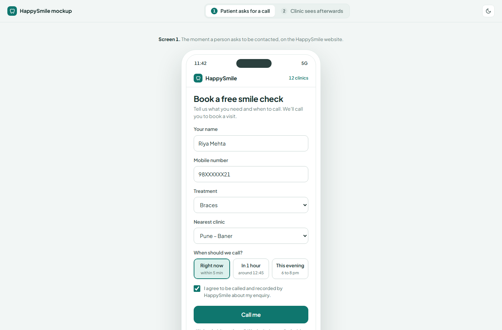
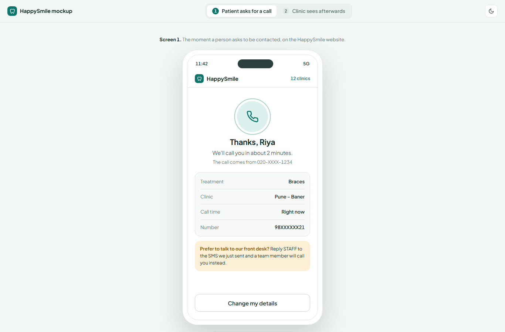
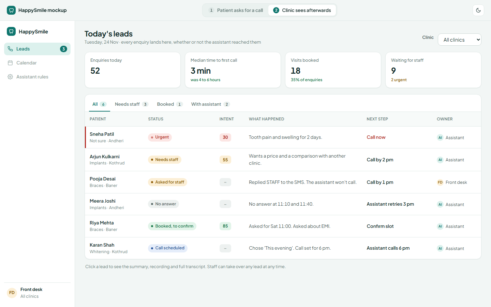
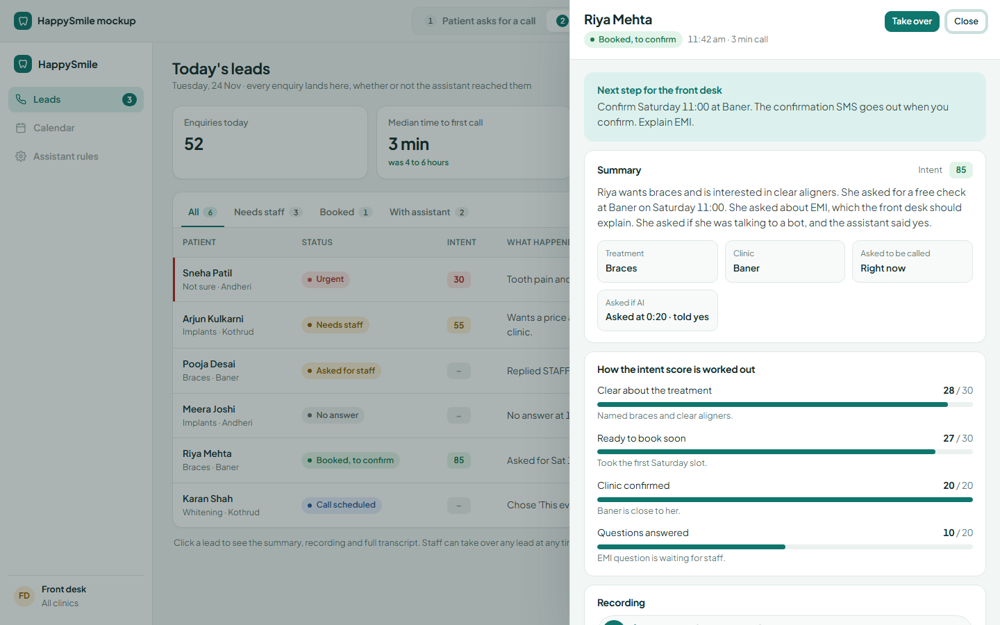

# HappySmile Call Assistant

A clickable product mockup of an AI voice assistant for **HappySmile**, a fictional chain of 12 dental clinics in India. It calls people back within minutes of an online enquiry, books a free check-up or hands them to the front desk, and shows staff everything that happened.

**Live demo:** https://happysmiles-demo-pi.vercel.app

| Screen | Link |
|---|---|
| 1. The moment a person asks to be contacted | https://happysmiles-demo-pi.vercel.app/#patient |
| 2. What HappySmile sees afterwards | https://happysmiles-demo-pi.vercel.app/#staff |

> This is a product case study. The clinic, patients, calls and numbers are made up.

---

## The problem

- About **300 people a day** enquire online about braces, whitening, implants and other treatments.
- The front desk calls them back **4 to 6 hours later**, and only about **30%** become booked appointments.
- Leads called within 5 minutes convert about **3x better**.

The goal is an AI voice assistant that reaches every interested person within minutes, qualifies them, and either books a visit or hands them to staff.

Three people had different views:

| Who | What they said | How this design answers it |
|---|---|---|
| Operations head | "Leads we call within 5 minutes convert 3x better." | The patient picks a call time, and "Right now" means within 5 minutes. |
| Founder | "The AI should sound so human that nobody realises it's AI." | The assistant sounds natural and introduces itself as HappySmile's **virtual assistant**, not as a person. It **never claims to be human** and confirms it's an AI whenever asked. |
| Front-desk lead | "Every lead should still go to my team. I don't trust a bot with patients." | Every enquiry lands on the staff dashboard, whether or not the AI reached the person. Staff can take over any lead at any time. |

---

## Screen 1: the patient asks for a call

 

What the person sees on the HappySmile website:

1. **A short form:** name, mobile number, treatment and nearest clinic.
2. **"When should we call?"** with three options:
   - **Right now:** within 5 minutes.
   - **In 1 hour.**
   - **This evening:** between 6 and 8 pm.
3. **Consent:** "I agree to be called and recorded". **Call me** stays disabled until it's ticked.
4. **Confirmation:** "We'll call you in about 2 minutes". The time follows the option picked. The screen also shows:
   - the number the call will come from;
   - a summary of the details;
   - the option to reply **STAFF** to the SMS and get a person instead.
5. **Expectations are set upfront:** the assistant books visits but gives no medical advice or final prices by phone.

## Screen 2: what the clinic sees afterwards



A front-desk dashboard for the day:

- **Stats:**
  - enquiries today;
  - median time to first call (3 min, against 4 to 6 hours before);
  - visits booked;
  - leads waiting for staff.
- **Every lead, not just answered calls:**

  | Status | Meaning |
  |---|---|
  | Urgent | Pain or swelling. Handed to staff at once and shown at the top with a red marker. |
  | Needs staff | Price, EMI, comparisons or anything the assistant must not answer. |
  | Asked for staff | The person replied STAFF, so the assistant never calls. |
  | No answer | The assistant retries once, then the lead moves to staff. |
  | Booked, to confirm | The assistant requested a slot, and staff confirm it before the SMS goes out. |
  | Call scheduled | The person chose "This evening", so the call hasn't happened yet. |

- **Tabs and a clinic filter:** All, Needs staff, Booked, and With assistant.
- **An owner column:** shows whether the assistant or the front desk owns each lead.

### Call details



Clicking a lead opens a side panel with:

- **The next step for the front desk**, colour-coded by urgency.
- **A summary**, plus treatment, clinic, chosen call time, and whether the person asked if it was an AI.
- **The intent score (0 to 100)** and how it's worked out:
  - clear about the treatment;
  - ready to book soon;
  - clinic confirmed;
  - questions answered.
- **The recording**, which the patient agreed to on the form.
- **The full transcript**, with flags on key moments: "Asked if AI: answered honestly", "Switched to Hindi", "Price handed to staff", "Urgent".
- **A Take over button** that moves the lead to the front desk.

For leads with no call yet (scheduled, no answer, asked for staff), the panel shows a **timeline** instead.

---

## How the assistant behaves

| Situation | What the assistant does |
|---|---|
| Start of every call | Introduces itself as "Priya, a virtual assistant from HappySmile". |
| Person asks "are you a bot / real person?" | Says honestly that it's an AI assistant for HappySmile and offers the front desk. |
| Any other time | Never claims or implies it's human. |
| Person speaks Hindi | Switches to Hindi. |
| Price, EMI, comparison with another clinic | Doesn't answer. Hands to staff with a callback time. |
| Pain, swelling or any medical symptom | Gives no advice. Hands to staff at once and marks the lead urgent. |
| Person agrees a slot | Requests it from slots held for the assistant. Staff confirm, then the SMS goes out. |
| Person wants a human | Hands over at once. They can also reply STAFF before the call. |
| No answer | One more try later. If there's still no answer, the lead goes to staff. |

The transcripts in the demo show these rules in action:

- **Riya:** asks if it's an AI, then books.
- **Arjun:** speaks Hindi and asks for a price.
- **Sneha:** is in pain, so the call is urgent.

---

## Product decisions and the reasoning

**1. Let the patient choose when to be called.** Calling within 5 minutes converts best, but only if the person can talk. "Right now / in 1 hour / this evening" keeps the speed and avoids calls to people who are driving or at work.

**2. Every lead goes to the front desk.** The assistant makes the first, fast call, and the team owns everything after it. That's what earns the front desk's trust. It's also safer, because nothing an AI can't handle gets lost.

**3. Honest when asked, never pretending.** The founder wants the call to feel human. The assistant sounds natural and opens as HappySmile's "virtual assistant" rather than pretending to be a staff member. It doesn't lead with "I am an AI", but when someone asks, it always tells the truth and never claims to be a person. Being caught lying on a recorded health call would cost more than any extra bookings.

**4. No medical advice, no prices.** These answers need a dentist or a check-up. Getting them wrong is a clinical and trust risk, so they always go to staff.

**5. Staff confirm bookings.** Clinic calendars are often partly on paper. If the assistant booked straight into a calendar that might be out of date, it could double-book a chair. It requests a slot instead, and a person confirms it.

### First 4 weeks

A pilot at 2 clinics on half of new enquiries. The other half get today's callback, so the two can be compared.

**Not doing yet:**
- prices;
- medical advice;
- treatment suggestions;
- payments;
- calling old leads;
- calls outside 9 am to 8 pm;
- all 12 clinics.

### Metrics

- **Success metric:** the share of enquiries that **attend** a visit within 14 days. A booking that doesn't show up earns nothing.
- **Deliberately ignored:** the share of calls the AI completes without staff. Pushing it up teaches the assistant to avoid handovers, which is exactly what the front desk fears.

### Biggest risk in month one

Bookings that don't match the real clinic calendar. A double-booked chair would make the front desk re-call every AI lead, and callbacks would be back to 4 to 6 hours. The mitigation is a block of slots each clinic holds for the assistant, plus staff confirmation before any SMS goes out.

The second risk comes from the disclosure choice. Some callers may work out mid-call that it's an AI without having asked, and feel misled. Watch hang-ups and complaints that mention "bot", and be ready to move the disclosure into the first line.

### Questions to ask HappySmile before building

1. Does the 30% mean booked or attended, and what's the no-show rate?
2. Where do appointments live at each clinic, and can a system write to them?
3. Can we listen to 30 recent front-desk callback calls to learn the languages, questions and handover points?

---

## How the code works

The whole mockup is a single static file, **`index.html`**. It has no build step and no dependencies apart from one Google Font.

```
happysmile-site/
├── index.html          # both screens: HTML, CSS and JavaScript
├── vercel.json         # Vercel settings (clean URLs)
├── docs/screenshots/   # images used in this README
└── README.md
```

- **Two screens, one page:** the URL hash picks the screen: `#patient` (default) or `#staff`. The switch at the top just changes the hash, so each screen has its own shareable link.
- **Screen 1:** a normal HTML form. Submitting it swaps the form for the confirmation state and fills it from the chosen options. Nothing is sent anywhere.
- **Screen 2:** the leads are a JavaScript array at the bottom of `index.html`. The table, tabs, clinic filter and side panel are all rendered from that array, so you can add or edit a lead by editing the data.
- **Theme:**
  - Light and dark mode follow the device setting.
  - The moon button switches between them, and the choice is saved in the browser.
  - Colours are CSS variables at the top of the file.
- **Accessibility:**
  - Rows and buttons work with the keyboard.
  - Esc closes the side panel, and focus stays inside it while it's open.
  - Animations turn off when the device asks for reduced motion.

### Run it locally

Open `index.html` in a browser. Or serve the folder:

```bash
npx serve .
```

### Deploy

The site is hosted on Vercel:

```bash
npx vercel deploy --prod
```

---

## What a real build would add

- **Voice:** a voice-agent platform (speech-to-text, LLM, text-to-speech) running the rules above, in English and Hindi first.
- **Telephony:** a calling provider for outbound calls, recordings and the STAFF SMS reply.
- **Integrations:** the clinics' appointment system (or a held-slot block), the website enquiry form, and SMS.
- **Backend:** storage for leads, calls, transcripts and summaries, with access limited to clinic staff and recordings deleted after a set time.
- **Weekly quality review:** the front-desk lead reads 20 transcripts a week and can change the handover rules or pause a clinic.
